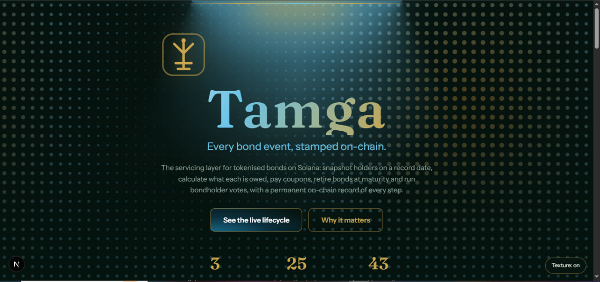
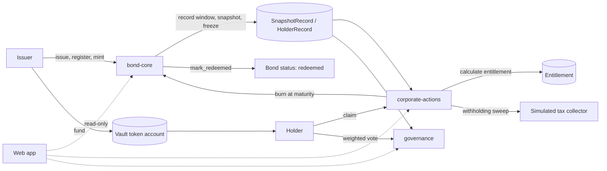

# Tamga

**Every bond event, stamped on-chain.**

Tamga (technical name: *KASE Corporate Action Engine*) is the servicing layer for tokenised bonds on Solana. It snapshots holders on a record date, calculates what each holder is owed, lets holders claim coupon and redemption payments, retires the bonds at maturity, runs weighted bondholder votes, and keeps a permanent on-chain record of every action.

Built for the Superteam Kazakhstan x KASE side track of the Colosseum Crypto World's Fair 2026 hackathon. A *tamga* is the steppe seal that marks ownership and authenticity.



## What it does

| Contest requirement | Status | Where |
|---|---|---|
| Test tokenised instrument | IMPLEMENTED | `bond-core`: `issue_bond`, `mint_bonds` |
| Holder registry | IMPLEMENTED | `bond-core`: `register_holder`, `HolderRecord` |
| Record-date mechanism | IMPLEMENTED | `bond-core`: record window, `snapshot_holder`, `close_record_window` |
| Entitlement calculation | IMPLEMENTED | `corporate-actions`: `calculate_entitlement`, `math.rs` |
| Coupon payment | IMPLEMENTED | `create_coupon_action`, `fund_action`, `claim_coupon` |
| Bond redemption with burn | IMPLEMENTED | `create_redemption_action`, `claim_redemption`, `mark_redeemed` |
| Additional action: bondholder voting | IMPLEMENTED | `governance`: `create_proposal`, `cast_vote`, `finalize_proposal` |
| Verifiable on-chain record | IMPLEMENTED | `CorporateAction`, `Entitlement`, `Proposal`, `VoteRecord` accounts |

## Devnet deployment

| Program | Address |
|---|---|
| bond-core | `GsYLz1ieJSo267DW3oga1k4hAmVoqTHgKaEw2K5HxJPT` |
| corporate-actions | `59hoGMNeum386CpHQpbsUStq51vfXS9iYxPkq5apthNg` |
| governance | `D4Zh5HNxQwuzqFJFsw5BFNBfkAGtW7Efk5VRTnFNwEqg` |

Upgrade authority: `9f7SqVfYGiGFEAJMxpDwdXLpbuZopGNq9M9GyyBD5fHh`. The sha256 of each deployed program matched the locally tested build. Explorer shows "not verified" because we have not run a Docker verifiable build (future work).

Sample bond from our recorded run: `8oC6TyaooxbUJsLM6JfUkUe4bngi7uwwUCmdy9fbWdK9` (payment mint `8D8W6pPWMB3MFkW9riBhh7yF3RsnLQWaoXY7J5Ue6Fga`). Paste it into the search box in the app to read it from devnet.

## Technical overview

### 1. Architecture



Three Anchor programs: **bond-core** (issuance, holder registry, record-date engine), **corporate-actions** (entitlement calculator, payment execution, audit records) and **governance** (voting). The web app is read-only.

### 2. Record-date logic

The record date is a **window**, not a single instant:
1. The issuer opens a record window (`open_record_window`).
2. For each holder, `snapshot_holder` records the holder's balance and **freezes** their bond token account, so the balance cannot move while the snapshot is taken.
3. `close_record_window` only succeeds when the snapshotted balances add up to the full mint supply. Nobody can be missed or counted twice.
4. The snapshot is the single source of truth for the entitlement and for votes. Entitlements and votes must finish before the next window opens.

Known limitation: bonds sent to an unregistered wallet stall `close_record_window` (future work: a Token-2022 transfer hook).

### 3. Entitlement calculations

All maths is integer-only (`u128`, rounded down) in `math.rs`.
- Coupon per holder = `balance x face value x annual rate / coupons per year`.
- Spec example: face 1,000, 10% a year, paid twice a year, 10 bonds = **500** per coupon.
- Redemption = `balance x face value` plus the final coupon, so 10 bonds at 1,000 face = 10,000 + 500.
- Withholding tax applies to the **coupon part only**, never the principal. Default 0%; the demo uses a simulated 15% for a foreign holder, in basis points. It is swept once to a simulated tax collector.
- The coupon ledger's `total_coupons` includes the final coupon paid with redemption. Regular coupons are capped at `total_coupons - 1`.

### 4. Settlement flow

Payouts are **claim-based** through a per-action vault, with no push to every holder:
1. `create_coupon_action` / `create_redemption_action` records the action against a snapshot.
2. `calculate_entitlement` stores each holder's amount on-chain.
3. The issuer funds the vault (`fund_action`).
4. `sweep_withholding` moves the tax part out once.
5. Each holder claims (`claim_coupon` / `claim_redemption`). For redemption, `thaw_holder` is bundled first in the same transaction (if the account is frozen), then the principal and final coupon are paid and exactly the snapshot quantity is burned.
6. `mark_redeemed` is permissionless and only succeeds when mint supply is 0.

### 5. Solana components

Anchor programs and PDAs (`BondState`, `HolderRecord`, `SnapshotRecord`, `BondLedger`, `CorporateAction`, `Entitlement`, `Proposal`, `VoteRecord`), the SPL Token program (mint, freeze authority, burn), a vault token account per action, and cross-program reads between the three programs. 25 LiteSVM integration tests cover issuance, registry, snapshot freeze and completion rules, the 500 coupon example, withholding, funding rules, permissions, the ledger cap, redemption with burn, and governance.

## Verified devnet run (43 transactions, all checks passed)

Setup: face KZT* 1,000.00, 10% a year, semi-annual, 2 coupons in total, foreign withholding 15%. Holders: A domestic 10 bonds, B foreign 5 bonds, C domestic 20 bonds.

| Holder | Bonds | Total paid (coupon + redemption), KZT* |
|---|---|---|
| A (domestic) | 10 | 11,000.00 |
| B (foreign, 15% on coupons) | 5 | 5,425.00 |
| C (domestic) | 20 | 22,000.00 |
| Tax collector (simulated) | | 75.00 |

All bonds burned, bond status `redeemed`, and the proposal "Approve covenant waiver" passed (A and C For, B Against, weighted by bonds held). The run is in `web/scripts/lifecycle.ts`; the web app shows its output from `web/public/demo-state.json`, with an Explorer link for each of the 43 transactions.

## IMPLEMENTED vs SIMULATED

**IMPLEMENTED (on Solana devnet):** all three programs, tokenised bond, holder registry, record-date window with freeze, entitlement maths, coupon, redemption with burn, weighted voting, on-chain audit records, 25 passing tests, and the 43-transaction lifecycle.

**SIMULATED:** the payment token (a test SPL token labelled KZT*, 2 decimals), jurisdiction flags and the 15% foreign withholding rate (demo parameters, not tax advice), the tax authority, and any KASE or depository integration. Fiat rails are out of scope.

## Run it

Requirements: Rust, Solana CLI, Anchor CLI 1.2.0, Node 20.

```bash
# on-chain: build and run the 25 tests
./scripts/test.sh

# web app (reads public/demo-state.json, and reads devnet directly for the search box)
cd web && npm install && npm run dev      # http://localhost:3000

# re-run the full lifecycle on devnet (about 8 minutes, needs a funded devnet keypair)
cd web && npx tsx scripts/lifecycle.ts
```

## Future work

Token-2022 transfer hook so transfers to unregistered wallets are handled, Docker verified builds and Security.txt, a depository and fiat settlement integration, early or partial redemption, and real tax-rule modules per jurisdiction.

## Disclaimer

Hackathon prototype on devnet. Not audited, not financial or tax advice. No KASE or Superteam branding is used.
